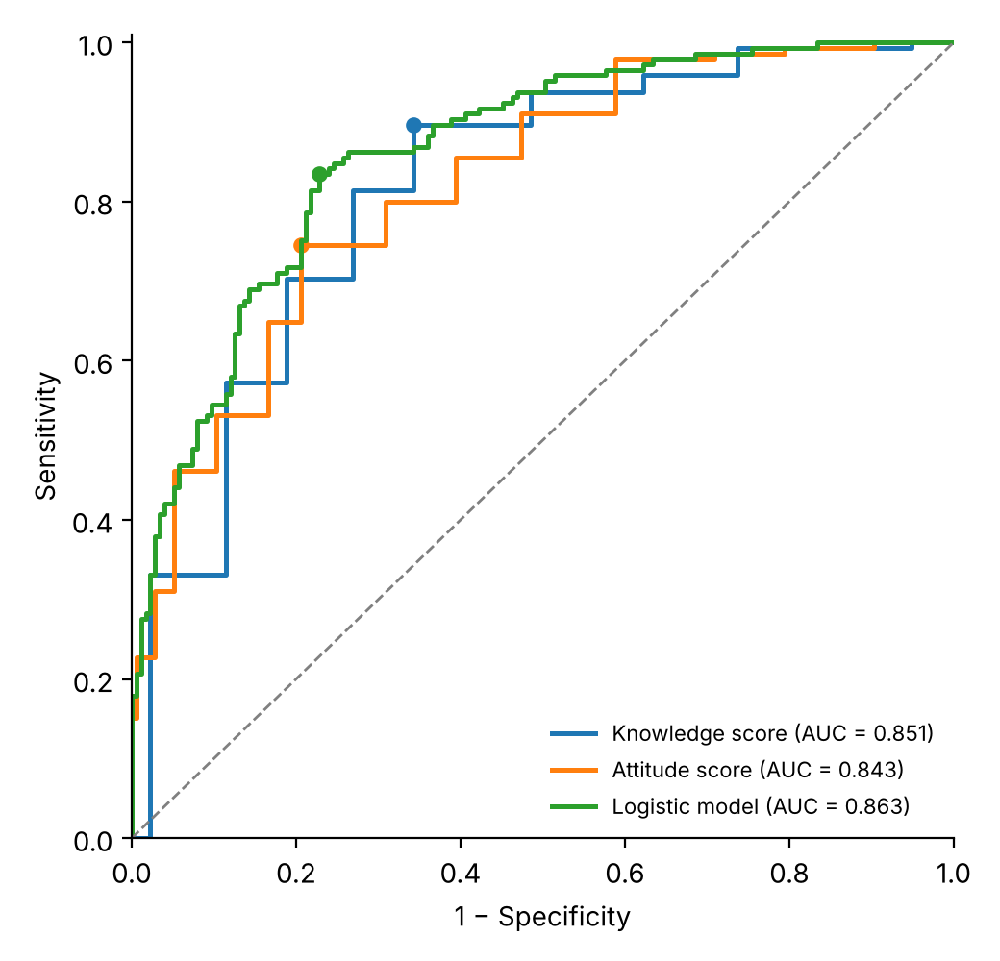

# Knowledge, Attitude and Practice of Nurses Towards Diabetic Foot Care

## Statistical analysis (methods text)

Data were analysed using descriptive and inferential statistics. Categorical variables were summarised as frequencies and percentages, and continuous variables as mean ± SD or median (IQR) according to normality (Shapiro–Wilk test). Internal consistency was assessed using Cronbach's alpha. Group differences were examined using the independent t-test/one-way ANOVA or their non-parametric equivalents (Mann–Whitney U/Kruskal–Wallis), and associations between categorical variables using the chi-square or Fisher's exact test. Correlations were assessed using Spearman's rank correlation. Binary logistic regression was used to identify independent predictors, reporting adjusted odds ratios (AOR) with 95% confidence intervals. Discriminative ability was assessed using receiver operating characteristic (ROC) curve analysis and the area under the curve (AUC), and the optimal cut-off was identified using the Youden index. Statistical significance was set at p < 0.05.

## 1. Characteristics of the participants

**Table 1. Socio-demographic characteristics of the participants (N = 320)**

| Variable          | Category      |   n |    % |
|:------------------|:--------------|----:|-----:|
| Age group         |               |     |      |
|                   | 30-39         | 141 | 44.1 |
|                   | 40+           |  73 | 22.8 |
|                   | <30           | 106 | 33.1 |
| Gender            |               |     |      |
|                   | Female        | 212 | 66.2 |
|                   | Male          | 108 | 33.8 |
| Nationality       |               |     |      |
|                   | Non-Omani     | 146 | 45.6 |
|                   | Omani         | 174 | 54.4 |
| Education         |               |     |      |
|                   | Bachelor      | 184 | 57.5 |
|                   | Diploma       |  93 | 29.1 |
|                   | Postgraduate  |  43 | 13.4 |
| Experience        |               |     |      |
|                   | 5-10 years    | 117 | 36.6 |
|                   | <5 years      | 104 | 32.5 |
|                   | >10 years     |  99 | 30.9 |
| Facility          |               |     |      |
|                   | Health center | 162 | 50.6 |
|                   | Hospital      | 158 | 49.4 |
| Previous training |               |     |      |
|                   | No            | 182 | 56.9 |
|                   | Yes           | 138 | 43.1 |

A total of 320 participants were included in the analysis. The most frequent categories were: Age group: 30-39 (44.1%); Gender: Female (66.2%); Nationality: Omani (54.4%); Education: Bachelor (57.5%); Experience: 5-10 years (36.6%); Facility: Health center (50.6%); Previous training: No (56.9%) (Table 1).

## 2. Reliability of the study instrument

**Table 2. Internal consistency of the questionnaire domains**

| Scale     |   No. of items |   n |   Cronbach's α | Interpretation   |
|:----------|---------------:|----:|---------------:|:-----------------|
| Knowledge |             10 | 320 |          0.825 | good             |
| Attitude  |              8 | 320 |          0.775 | acceptable       |
| Practice  |              7 | 320 |          0.629 | questionable     |

*α ≥ 0.70 considered acceptable (Nunnally, 1978).*

Internal consistency was assessed using Cronbach's alpha: Knowledge (α = 0.825, good), Attitude (α = 0.775, acceptable), Practice (α = 0.629, questionable).

## 3. Overall scores and levels

**Table 3. Distribution of scores and levels by domain**

| Domain    | Possible range   | Mean ± SD    | Median (IQR)        | Poor n (%)   | Moderate n (%)   | Good n (%)   | Negative n (%)   | Neutral n (%)   | Positive n (%)   | Fair n (%)   |
|:----------|:-----------------|:-------------|:--------------------|:-------------|:-----------------|:-------------|:-----------------|:----------------|:-----------------|:-------------|
| Knowledge | 0–10             | 6.22 ± 3.01  | 7.00 (4.00–9.00)    | 130 (40.6)   | 55 (17.2)        | 135 (42.2)   | nan              | nan             | nan              | nan          |
| Attitude  | 8–40             | 29.59 ± 4.83 | 30.00 (27.00–33.00) | nan          | nan              | nan          | 105 (32.8)       | 139 (43.4)      | 76 (23.8)        | nan          |
| Practice  | 0–7              | 4.18 ± 1.91  | 4.00 (3.00–6.00)    | 175 (54.7)   | nan              | 86 (26.9)    | nan              | nan             | nan              | 59 (18.4)    |

*Levels classified using percentage-score cut-offs at 60, 80% (modified Bloom's criteria).*

The mean knowledge score was 6.22 ± 3.01 out of 10; levels were poor (40.6%), moderate (17.2%), good (42.2%).

The mean attitude score was 29.59 ± 4.83 out of 40; levels were negative (32.8%), neutral (43.4%), positive (23.8%).

The mean practice score was 4.18 ± 1.91 out of 7; levels were poor (54.7%), fair (18.4%), good (26.9%).

## 4. Item-level responses

**Table 4. Item-level responses — Knowledge domain, n (%)**

| Item   | 0          | 1          |
|:-------|:-----------|:-----------|
| K1     | 104 (32.5) | 216 (67.5) |
| K2     | 100 (31.2) | 220 (68.8) |
| K3     | 99 (30.9)  | 221 (69.1) |
| K4     | 119 (37.2) | 201 (62.8) |
| K5     | 112 (35.0) | 208 (65.0) |
| K6     | 126 (39.4) | 194 (60.6) |
| K7     | 120 (37.5) | 200 (62.5) |
| K8     | 141 (44.1) | 179 (55.9) |
| K9     | 147 (45.9) | 173 (54.1) |
| K10    | 141 (44.1) | 179 (55.9) |

**Table 5. Item-level responses — Attitude domain, n (%)**

| Item   | 1         | 2          | 3          | 4          | 5         |
|:-------|:----------|:-----------|:-----------|:-----------|:----------|
| A1     | 7 (2.2)   | 32 (10.0)  | 92 (28.8)  | 119 (37.2) | 70 (21.9) |
| A2     | 3 (0.9)   | 34 (10.6)  | 93 (29.1)  | 117 (36.6) | 73 (22.8) |
| A3     | 3 (0.9)   | 32 (10.0)  | 107 (33.4) | 98 (30.6)  | 80 (25.0) |
| A4     | 8 (2.5)   | 22 (6.9)   | 94 (29.4)  | 128 (40.0) | 68 (21.2) |
| A5     | 8 (2.5)   | 26 (8.1)   | 91 (28.4)  | 127 (39.7) | 68 (21.2) |
| A6     | 0 (0.0)   | 35 (10.9)  | 96 (30.0)  | 120 (37.5) | 69 (21.6) |
| A7     | 5 (1.6)   | 28 (8.8)   | 97 (30.3)  | 116 (36.2) | 74 (23.1) |
| A8     | 78 (24.4) | 119 (37.2) | 89 (27.8)  | 31 (9.7)   | 3 (0.9)   |

**Table 6. Item-level responses — Practice domain, n (%)**

| Item   | 0          | 1          |
|:-------|:-----------|:-----------|
| P1     | 129 (40.3) | 191 (59.7) |
| P2     | 129 (40.3) | 191 (59.7) |
| P3     | 132 (41.2) | 188 (58.8) |
| P4     | 137 (42.8) | 183 (57.2) |
| P5     | 119 (37.2) | 201 (62.8) |
| P6     | 130 (40.6) | 190 (59.4) |
| P7     | 126 (39.4) | 194 (60.6) |

## 5. Differences in scores across participant characteristics

**Table 7. Comparison of Knowledge score across participant characteristics**

| Variable          | Category      |   n | Mean ± SD   | Test               | Statistic   | p        | Effect size       |
|:------------------|:--------------|----:|:------------|:-------------------|:------------|:---------|:------------------|
| Age group         | 30-39         | 141 | 5.96 ± 2.99 | One-way ANOVA      | F = 1.29    | 0.276    | η² = 0.01         |
|                   | 40+           |  73 | 6.66 ± 3.12 |                    |             |          |                   |
|                   | <30           | 106 | 6.26 ± 2.95 |                    |             |          |                   |
| Gender            | Female        | 212 | 6.14 ± 3.02 | Independent t-test | t = -0.71   | 0.480    | Cohen's d = -0.08 |
|                   | Male          | 108 | 6.39 ± 3.00 |                    |             |          |                   |
| Nationality       | Non-Omani     | 146 | 6.29 ± 3.03 | Independent t-test | t = 0.39    | 0.693    | Cohen's d = 0.04  |
|                   | Omani         | 174 | 6.16 ± 3.00 |                    |             |          |                   |
| Education         | Bachelor      | 184 | 6.34 ± 3.10 | One-way ANOVA      | F = 2.80    | 0.062    | η² = 0.02         |
|                   | Diploma       |  93 | 5.68 ± 2.92 |                    |             |          |                   |
|                   | Postgraduate  |  43 | 6.91 ± 2.69 |                    |             |          |                   |
| Experience        | 5-10 years    | 117 | 5.79 ± 3.16 | One-way ANOVA      | F = 3.17    | 0.043*   | η² = 0.02         |
|                   | <5 years      | 104 | 6.15 ± 2.89 |                    |             |          |                   |
|                   | >10 years     |  99 | 6.81 ± 2.88 |                    |             |          |                   |
| Facility          | Health center | 162 | 5.95 ± 3.09 | Independent t-test | t = -1.64   | 0.103    | Cohen's d = -0.18 |
|                   | Hospital      | 158 | 6.50 ± 2.91 |                    |             |          |                   |
| Previous training | No            | 182 | 5.29 ± 2.98 | Welch's t-test     | t = -6.92   | < 0.001* | Cohen's d = -0.77 |
|                   | Yes           | 138 | 7.45 ± 2.59 |                    |             |          |                   |

*Test selected automatically from normality (Shapiro–Wilk) and homogeneity (Levene). * Significant at p < 0.05.*

Knowledge score differed significantly by Experience (One-way ANOVA, F = 3.17, p = 0.043; highest among '>10 years'); Previous training (Welch's t-test, t = -6.92, p < 0.001; highest among 'Yes').

**Table 8. Comparison of Attitude score across participant characteristics**

| Variable          | Category      |   n | Mean ± SD    | Test               | Statistic   | p        | Effect size       |
|:------------------|:--------------|----:|:-------------|:-------------------|:------------|:---------|:------------------|
| Age group         | 30-39         | 141 | 29.15 ± 4.69 | One-way ANOVA      | F = 1.29    | 0.276    | η² = 0.01         |
|                   | 40+           |  73 | 30.23 ± 4.95 |                    |             |          |                   |
|                   | <30           | 106 | 29.75 ± 4.91 |                    |             |          |                   |
| Gender            | Female        | 212 | 29.27 ± 4.90 | Independent t-test | t = -1.67   | 0.097    | Cohen's d = -0.20 |
|                   | Male          | 108 | 30.22 ± 4.66 |                    |             |          |                   |
| Nationality       | Non-Omani     | 146 | 29.93 ± 4.95 | Independent t-test | t = 1.15    | 0.253    | Cohen's d = 0.13  |
|                   | Omani         | 174 | 29.31 ± 4.72 |                    |             |          |                   |
| Education         | Bachelor      | 184 | 29.90 ± 4.71 | One-way ANOVA      | F = 6.60    | 0.002*   | η² = 0.04         |
|                   | Diploma       |  93 | 28.25 ± 4.93 |                    |             |          |                   |
|                   | Postgraduate  |  43 | 31.21 ± 4.51 |                    |             |          |                   |
| Experience        | 5-10 years    | 117 | 28.86 ± 4.74 | One-way ANOVA      | F = 3.42    | 0.034*   | η² = 0.02         |
|                   | <5 years      | 104 | 29.49 ± 4.69 |                    |             |          |                   |
|                   | >10 years     |  99 | 30.57 ± 4.97 |                    |             |          |                   |
| Facility          | Health center | 162 | 29.49 ± 5.02 | Independent t-test | t = -0.37   | 0.709    | Cohen's d = -0.04 |
|                   | Hospital      | 158 | 29.70 ± 4.64 |                    |             |          |                   |
| Previous training | No            | 182 | 28.24 ± 4.72 | Independent t-test | t = -6.06   | < 0.001* | Cohen's d = -0.68 |
|                   | Yes           | 138 | 31.38 ± 4.39 |                    |             |          |                   |

*Test selected automatically from normality (Shapiro–Wilk) and homogeneity (Levene). * Significant at p < 0.05.*

Attitude score differed significantly by Education (One-way ANOVA, F = 6.60, p = 0.002; highest among 'Postgraduate'); Experience (One-way ANOVA, F = 3.42, p = 0.034; highest among '>10 years'); Previous training (Independent t-test, t = -6.06, p < 0.001; highest among 'Yes').

**Table 9. Comparison of Practice score across participant characteristics**

| Variable          | Category      |   n | Mean ± SD   | Test               | Statistic   | p        | Effect size       |
|:------------------|:--------------|----:|:------------|:-------------------|:------------|:---------|:------------------|
| Age group         | 30-39         | 141 | 3.98 ± 1.85 | One-way ANOVA      | F = 3.99    | 0.020*   | η² = 0.02         |
|                   | 40+           |  73 | 4.73 ± 2.00 |                    |             |          |                   |
|                   | <30           | 106 | 4.08 ± 1.89 |                    |             |          |                   |
| Gender            | Female        | 212 | 4.22 ± 2.01 | Welch's t-test     | t = 0.49    | 0.623    | Cohen's d = 0.06  |
|                   | Male          | 108 | 4.11 ± 1.71 |                    |             |          |                   |
| Nationality       | Non-Omani     | 146 | 4.34 ± 1.95 | Independent t-test | t = 1.38    | 0.168    | Cohen's d = 0.16  |
|                   | Omani         | 174 | 4.05 ± 1.87 |                    |             |          |                   |
| Education         | Bachelor      | 184 | 4.29 ± 1.94 | One-way ANOVA      | F = 8.06    | < 0.001* | η² = 0.05         |
|                   | Diploma       |  93 | 3.61 ± 1.85 |                    |             |          |                   |
|                   | Postgraduate  |  43 | 4.93 ± 1.59 |                    |             |          |                   |
| Experience        | 5-10 years    | 117 | 3.96 ± 2.02 | One-way ANOVA      | F = 3.80    | 0.023*   | η² = 0.02         |
|                   | <5 years      | 104 | 4.02 ± 1.85 |                    |             |          |                   |
|                   | >10 years     |  99 | 4.62 ± 1.78 |                    |             |          |                   |
| Facility          | Health center | 162 | 4.09 ± 1.98 | Independent t-test | t = -0.90   | 0.370    | Cohen's d = -0.10 |
|                   | Hospital      | 158 | 4.28 ± 1.84 |                    |             |          |                   |
| Previous training | No            | 182 | 3.67 ± 1.91 | Independent t-test | t = -5.76   | < 0.001* | Cohen's d = -0.65 |
|                   | Yes           | 138 | 4.86 ± 1.71 |                    |             |          |                   |

*Test selected automatically from normality (Shapiro–Wilk) and homogeneity (Levene). * Significant at p < 0.05.*

Practice score differed significantly by Age group (One-way ANOVA, F = 3.99, p = 0.020; highest among '40+'); Education (One-way ANOVA, F = 8.06, p < 0.001; highest among 'Postgraduate'); Experience (One-way ANOVA, F = 3.80, p = 0.023; highest among '>10 years'); Previous training (Independent t-test, t = -5.76, p < 0.001; highest among 'Yes').

## 6. Factors associated with the outcome levels

**Table 10. Association between participant characteristics and Knowledge level**

| Variable          | Category     | Good n (%)   | Moderate n (%)   | Poor n (%)   | χ² (df)   | p        |   Cramér's V |
|:------------------|:-------------|:-------------|:-----------------|:-------------|:----------|:---------|-------------:|
| Gender            | Female       | 87 (41.0)    | 35 (16.5)        | 90 (42.5)    | 0.88 (2)  | 0.644    |         0.05 |
|                   | Male         | 48 (44.4)    | 20 (18.5)        | 40 (37.0)    |           |          |              |
| Education         | Bachelor     | 83 (45.1)    | 29 (15.8)        | 72 (39.1)    | 4.89 (4)  | 0.299    |         0.09 |
|                   | Diploma      | 31 (33.3)    | 18 (19.4)        | 44 (47.3)    |           |          |              |
|                   | Postgraduate | 21 (48.8)    | 8 (18.6)         | 14 (32.6)    |           |          |              |
| Experience        | 5-10 years   | 42 (35.9)    | 16 (13.7)        | 59 (50.4)    | 12.18 (4) | 0.016*   |         0.14 |
|                   | <5 years     | 42 (40.4)    | 18 (17.3)        | 44 (42.3)    |           |          |              |
|                   | >10 years    | 51 (51.5)    | 21 (21.2)        | 27 (27.3)    |           |          |              |
| Previous training | No           | 53 (29.1)    | 32 (17.6)        | 97 (53.3)    | 33.80 (2) | < 0.001* |         0.32 |
|                   | Yes          | 82 (59.4)    | 23 (16.7)        | 33 (23.9)    |           |          |              |

*Row percentages. Pearson chi-square test; ᶠ Fisher's exact test. * p < 0.05.*

Knowledge level was significantly associated with Experience (χ² = 12.18, p = 0.016, V = 0.14); Previous training (χ² = 33.80, p < 0.001, V = 0.32).

## 7. Correlations between domains

**Table 11. Spearman's rank correlation coefficients between domain scores**

| Variable        | Knowledge score   | Attitude score   |   Practice score |
|:----------------|:------------------|:-----------------|-----------------:|
| Knowledge score | 1                 |                  |                  |
| Attitude score  | 0.77**            | 1                |                  |
| Practice score  | 0.72**            | 0.70**           |                1 |

** p < 0.05; ** p < 0.01.*

Significant correlations were observed between Attitude score and Knowledge score (strong positive, rs = 0.77, p < 0.001); Practice score and Knowledge score (strong positive, rs = 0.72, p < 0.001); Practice score and Attitude score (strong positive, rs = 0.70, p < 0.001).

## 8. Predictors of the outcome (binary logistic regression)

**Table 12. Binary logistic regression for predictors of Adequate practice (event = 'Adequate')**

| Predictor                              |   Crude OR | Crude p   |      B |    SE |   AOR | 95% CI    | p        |
|:---------------------------------------|-----------:|:----------|-------:|------:|------:|:----------|:---------|
| Gender: Male (ref: Female)             |       0.8  | 0.350     | -0.628 | 0.311 |  0.53 | 0.29–0.98 | 0.044*   |
| Education: Bachelor (ref: Diploma)     |       1.87 | 0.018     |  0.544 | 0.334 |  1.72 | 0.90–3.31 | 0.103    |
| Education: Postgraduate (ref: Diploma) |       2.78 | 0.007     |  0.962 | 0.475 |  2.62 | 1.03–6.64 | 0.043*   |
| Experience: 5-10 years (ref: <5 years) |       0.95 | 0.847     |  0.137 | 0.356 |  1.15 | 0.57–2.30 | 0.700    |
| Experience: >10 years (ref: <5 years)  |       1.57 | 0.110     |  0.183 | 0.354 |  1.2  | 0.60–2.40 | 0.605    |
| Previous training: Yes (ref: No)       |       2.62 | < 0.001   |  0.235 | 0.304 |  1.26 | 0.70–2.29 | 0.440    |
| Knowledge score                        |       1.77 | < 0.001   |  0.565 | 0.067 |  1.76 | 1.54–2.01 | < 0.001* |

*AOR, adjusted odds ratio; CI, confidence interval. Model χ²(7) = 144.31, p < 0.001; Nagelkerke R² = 0.485; Hosmer–Lemeshow p = 0.703; correctly classified 77.8%. * p < 0.05.*

The multivariable model was statistically significant (χ²(7) = 144.31, p < 0.001; Nagelkerke R² = 0.485) and correctly classified 77.8% of cases. Independent predictors were: Gender: Male (ref: Female) (lower odds; AOR = 0.53, 95% CI: 0.29–0.98, p = 0.044); Education: Postgraduate (ref: Diploma) (higher odds; AOR = 2.62, 95% CI: 1.03–6.64, p = 0.043); Knowledge score (higher odds; AOR = 1.76, 95% CI: 1.54–2.01, p < 0.001).

## 9. Discriminative ability (ROC curve analysis)

**Table 13. Area under the ROC curve for predicting Adequate practice (event = 'Adequate')**

| Marker                                 |   n | AUC (95% CI)        | p        | Discrimination   |
|:---------------------------------------|----:|:--------------------|:---------|:-----------------|
| Knowledge score                        | 320 | 0.851 (0.810–0.892) | < 0.001* | excellent        |
| Attitude score                         | 320 | 0.843 (0.802–0.885) | < 0.001* | excellent        |
| Logistic model (predicted probability) | 320 | 0.863 (0.824–0.902) | < 0.001* | excellent        |

*AUC, area under the curve; 95% CI by DeLong; p tests H0: AUC = 0.5. Interpretation per Hosmer & Lemeshow (0.7–0.8 acceptable, 0.8–0.9 excellent, ≥ 0.9 outstanding). * p < 0.05.*

**Table 14. Diagnostic accuracy at the optimal cut-off points for predicting Adequate practice**

| Marker                                 | Cut-off   | Se % (95% CI)    | Sp % (95% CI)    |   PPV % |   NPV % |   LR+ |   LR− |   Youden J |
|:---------------------------------------|:----------|:-----------------|:-----------------|--------:|--------:|------:|------:|-----------:|
| Knowledge score                        | ≥ 6       | 89.7 (83.6–93.6) | 65.7 (58.4–72.3) |    68.4 |    88.5 |  2.61 |  0.16 |      0.554 |
| Attitude score                         | ≥ 31      | 74.5 (66.8–80.9) | 79.4 (72.8–84.8) |    75   |    79   |  3.62 |  0.32 |      0.539 |
| Logistic model (predicted probability) | ≥ 0.44    | 83.4 (76.6–88.6) | 77.1 (70.4–82.7) |    75.2 |    84.9 |  3.65 |  0.21 |      0.606 |

*Se, sensitivity; Sp, specificity; PPV/NPV, positive/negative predictive value; LR, likelihood ratio. Optimal cut-off by maximum Youden index (J = Se + Sp − 1). Se/Sp 95% CI by Wilson. Prevalence of event = 45.3%.*

Knowledge score showed excellent discrimination (AUC = 0.851, 95% CI: 0.810–0.892, p < 0.001). At the optimal cut-off of ≥ 6, sensitivity was 89.7% and specificity 65.7% (Youden J = 0.554).

Attitude score showed excellent discrimination (AUC = 0.843, 95% CI: 0.802–0.885, p < 0.001). At the optimal cut-off of ≥ 31, sensitivity was 74.5% and specificity 79.4% (Youden J = 0.539).

Logistic model (predicted probability) showed excellent discrimination (AUC = 0.863, 95% CI: 0.824–0.902, p < 0.001). At the optimal cut-off of ≥ 0.44, sensitivity was 83.4% and specificity 77.1% (Youden J = 0.606).

**Table 15. Pairwise comparison of AUCs (DeLong test)**

| Comparison                                                |   ΔAUC |     z |     p |   n |
|:----------------------------------------------------------|-------:|------:|------:|----:|
| Knowledge score vs Attitude score                         |  0.008 |  0.4  | 0.687 | 320 |
| Knowledge score vs Logistic model (predicted probability) | -0.012 | -1.73 | 0.083 | 320 |
| Attitude score vs Logistic model (predicted probability)  | -0.02  | -1.01 | 0.312 | 320 |

No significant differences were found between the AUCs of the compared markers (DeLong test).

**Figure 1. ROC curves for predicting Adequate practice**

