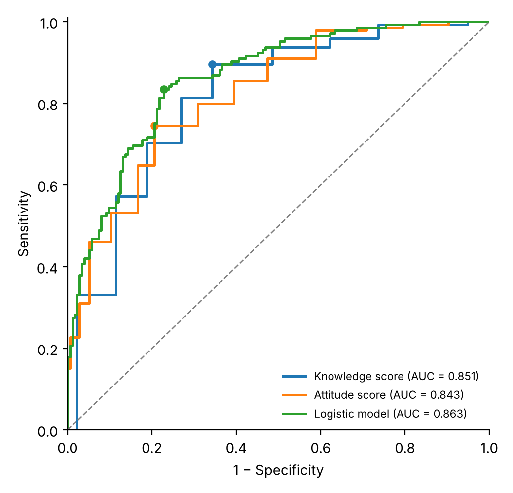

# معارف واتجاهات وممارسات الممرضين تجاه العناية بالقدم السكرية

## التحليل الإحصائي (نص المنهجية)

حُلِّلت البيانات باستخدام الإحصاء الوصفي والاستدلالي. لُخِّصت المتغيرات الفئوية بالتكرارات والنسب المئوية، والمتغيرات الكمية بالمتوسط ± الانحراف المعياري أو الوسيط (المدى الربيعي) بحسب اعتدالية التوزيع (اختبار Shapiro–Wilk). وقيس الاتساق الداخلي للأداة بمعامل ألفا كرونباخ (Cronbach's α). وفُحصت الفروق بين المجموعات باختبار t للعينات المستقلة أو تحليل التباين الأحادي (ANOVA) أو بدائلهما اللامعلمية (Mann–Whitney U / Kruskal–Wallis)، والعلاقة بين المتغيرات الفئوية باختبار مربع كاي (χ²) أو اختبار فيشر الدقيق. وقيس الارتباط بمعامل سبيرمان (Spearman). واستُخدم الانحدار اللوجستي الثنائي لتحديد العوامل المنبئة المستقلة، مع عرض نسب الأرجحية المعدّلة (AOR) وفترات ثقة 95%. وقُيِّمت القدرة التمييزية باستخدام تحليل منحنى خصائص التشغيل (ROC) والمساحة تحت المنحنى (AUC)، وحُدِّدت نقطة القطع المثلى بمؤشر Youden. وعُدَّت النتائج ذات دلالة إحصائية عند p < 0.05.

## 1. خصائص المشاركين

**جدول 1. الخصائص الديموغرافية والاجتماعية للمشاركين (N = 320)**

| المتغير        | الفئة            |   n |    % |
|:---------------|:-----------------|----:|-----:|
| الفئة العمرية  |                  |     |      |
|                | 30–39            | 141 | 44.1 |
|                | 40 فأكثر         |  73 | 22.8 |
|                | أقل من 30        | 106 | 33.1 |
| الجنس          |                  |     |      |
|                | أنثى             | 212 | 66.2 |
|                | ذكر              | 108 | 33.8 |
| الجنسية        |                  |     |      |
|                | غير عُماني       | 146 | 45.6 |
|                | عُماني           | 174 | 54.4 |
| المؤهل العلمي  |                  |     |      |
|                | بكالوريوس        | 184 | 57.5 |
|                | دبلوم            |  93 | 29.1 |
|                | دراسات عليا      |  43 | 13.4 |
| سنوات الخبرة   |                  |     |      |
|                | 5–10 سنوات       | 117 | 36.6 |
|                | أقل من 5 سنوات   | 104 | 32.5 |
|                | أكثر من 10 سنوات |  99 | 30.9 |
| المؤسسة الصحية |                  |     |      |
|                | مركز صحي         | 162 | 50.6 |
|                | مستشفى           | 158 | 49.4 |
| التدريب السابق |                  |     |      |
|                | لا               | 182 | 56.9 |
|                | نعم              | 138 | 43.1 |

شملت الدراسة 320 مشاركاً. وكانت الفئات الأكثر تكراراً: الفئة العمرية: 30–39 (44.1%)؛ الجنس: أنثى (66.2%)؛ الجنسية: عُماني (54.4%)؛ المؤهل العلمي: بكالوريوس (57.5%)؛ سنوات الخبرة: 5–10 سنوات (36.6%)؛ المؤسسة الصحية: مركز صحي (50.6%)؛ التدريب السابق: لا (56.9%) (جدول 1).

## 2. ثبات أداة الدراسة

**جدول 2. الاتساق الداخلي لمحاور الاستبانة**

| المحور    |   عدد البنود |   n |   Cronbach's α | التفسير   |
|:----------|-------------:|----:|---------------:|:----------|
| المعرفة   |           10 | 320 |          0.825 | جيد       |
| الاتجاهات |            8 | 320 |          0.775 | مقبول     |
| الممارسة  |            7 | 320 |          0.629 | مشكوك فيه |

*تُعدّ قيمة α ≥ 0.70 مقبولة (Nunnally, 1978).*

قيس الاتساق الداخلي بمعامل ألفا كرونباخ، وجاءت النتائج كالآتي: المعرفة (α = 0.825) جيد، الاتجاهات (α = 0.775) مقبول، الممارسة (α = 0.629) مشكوك فيه.

## 3. الدرجات الكلية والمستويات

**جدول 3. توزيع الدرجات والمستويات حسب المحور**

| المحور    | المدى الممكن   | المتوسط ± الانحراف المعياري   | الوسيط (المدى الربيعي)   | ضعيف n (%)   | متوسط n (%)   | جيد n (%)   | سلبي n (%)   | محايد n (%)   | إيجابي n (%)   | مقبول n (%)   |
|:----------|:---------------|:------------------------------|:-------------------------|:-------------|:--------------|:------------|:-------------|:--------------|:---------------|:--------------|
| المعرفة   | 0–10           | 6.22 ± 3.01                   | 7.00 (4.00–9.00)         | 130 (40.6)   | 55 (17.2)     | 135 (42.2)  | nan          | nan           | nan            | nan           |
| الاتجاهات | 8–40           | 29.59 ± 4.83                  | 30.00 (27.00–33.00)      | nan          | nan           | nan         | 105 (32.8)   | 139 (43.4)    | 76 (23.8)      | nan           |
| الممارسة  | 0–7            | 4.18 ± 1.91                   | 4.00 (3.00–6.00)         | 175 (54.7)   | nan           | 86 (26.9)   | nan          | nan           | nan            | 59 (18.4)     |

*صُنِّفت المستويات وفق نقاط قطع للنسبة المئوية للدرجة عند 60, 80% (معيار Bloom المعدّل).*

بلغ متوسط درجة المعرفة 6.22 ± 3.01 من أصل 10، وتوزعت المستويات كالآتي: ضعيف (40.6%)، متوسط (17.2%)، جيد (42.2%).

بلغ متوسط درجة الاتجاهات 29.59 ± 4.83 من أصل 40، وتوزعت المستويات كالآتي: سلبي (32.8%)، محايد (43.4%)، إيجابي (23.8%).

بلغ متوسط درجة الممارسة 4.18 ± 1.91 من أصل 7، وتوزعت المستويات كالآتي: ضعيف (54.7%)، مقبول (18.4%)، جيد (26.9%).

## 4. الاستجابات على مستوى البنود

**جدول 4. الاستجابات على بنود محور المعرفة، n (%)**

| البند   | 0          | 1          |
|:--------|:-----------|:-----------|
| K1      | 104 (32.5) | 216 (67.5) |
| K2      | 100 (31.2) | 220 (68.8) |
| K3      | 99 (30.9)  | 221 (69.1) |
| K4      | 119 (37.2) | 201 (62.8) |
| K5      | 112 (35.0) | 208 (65.0) |
| K6      | 126 (39.4) | 194 (60.6) |
| K7      | 120 (37.5) | 200 (62.5) |
| K8      | 141 (44.1) | 179 (55.9) |
| K9      | 147 (45.9) | 173 (54.1) |
| K10     | 141 (44.1) | 179 (55.9) |

**جدول 5. الاستجابات على بنود محور الاتجاهات، n (%)**

| البند   | 1         | 2          | 3          | 4          | 5         |
|:--------|:----------|:-----------|:-----------|:-----------|:----------|
| A1      | 7 (2.2)   | 32 (10.0)  | 92 (28.8)  | 119 (37.2) | 70 (21.9) |
| A2      | 3 (0.9)   | 34 (10.6)  | 93 (29.1)  | 117 (36.6) | 73 (22.8) |
| A3      | 3 (0.9)   | 32 (10.0)  | 107 (33.4) | 98 (30.6)  | 80 (25.0) |
| A4      | 8 (2.5)   | 22 (6.9)   | 94 (29.4)  | 128 (40.0) | 68 (21.2) |
| A5      | 8 (2.5)   | 26 (8.1)   | 91 (28.4)  | 127 (39.7) | 68 (21.2) |
| A6      | 0 (0.0)   | 35 (10.9)  | 96 (30.0)  | 120 (37.5) | 69 (21.6) |
| A7      | 5 (1.6)   | 28 (8.8)   | 97 (30.3)  | 116 (36.2) | 74 (23.1) |
| A8      | 78 (24.4) | 119 (37.2) | 89 (27.8)  | 31 (9.7)   | 3 (0.9)   |

**جدول 6. الاستجابات على بنود محور الممارسة، n (%)**

| البند   | 0          | 1          |
|:--------|:-----------|:-----------|
| P1      | 129 (40.3) | 191 (59.7) |
| P2      | 129 (40.3) | 191 (59.7) |
| P3      | 132 (41.2) | 188 (58.8) |
| P4      | 137 (42.8) | 183 (57.2) |
| P5      | 119 (37.2) | 201 (62.8) |
| P6      | 130 (40.6) | 190 (59.4) |
| P7      | 126 (39.4) | 194 (60.6) |

## 5. الفروق في الدرجات حسب خصائص المشاركين

**جدول 7. مقارنة درجة المعرفة حسب خصائص المشاركين**

| المتغير        | الفئة            |   n | المتوسط ± الانحراف المعياري   | الاختبار                    | قيمة الاختبار   | p        | حجم الأثر         |
|:---------------|:-----------------|----:|:------------------------------|:----------------------------|:----------------|:---------|:------------------|
| الفئة العمرية  | 30–39            | 141 | 5.96 ± 2.99                   | تحليل التباين الأحادي ANOVA | F = 1.29        | 0.276    | η² = 0.01         |
|                | 40 فأكثر         |  73 | 6.66 ± 3.12                   |                             |                 |          |                   |
|                | أقل من 30        | 106 | 6.26 ± 2.95                   |                             |                 |          |                   |
| الجنس          | أنثى             | 212 | 6.14 ± 3.02                   | اختبار t للعينات المستقلة   | t = -0.71       | 0.480    | Cohen's d = -0.08 |
|                | ذكر              | 108 | 6.39 ± 3.00                   |                             |                 |          |                   |
| الجنسية        | غير عُماني       | 146 | 6.29 ± 3.03                   | اختبار t للعينات المستقلة   | t = 0.39        | 0.693    | Cohen's d = 0.04  |
|                | عُماني           | 174 | 6.16 ± 3.00                   |                             |                 |          |                   |
| المؤهل العلمي  | بكالوريوس        | 184 | 6.34 ± 3.10                   | تحليل التباين الأحادي ANOVA | F = 2.80        | 0.062    | η² = 0.02         |
|                | دبلوم            |  93 | 5.68 ± 2.92                   |                             |                 |          |                   |
|                | دراسات عليا      |  43 | 6.91 ± 2.69                   |                             |                 |          |                   |
| سنوات الخبرة   | 5–10 سنوات       | 117 | 5.79 ± 3.16                   | تحليل التباين الأحادي ANOVA | F = 3.17        | 0.043*   | η² = 0.02         |
|                | أقل من 5 سنوات   | 104 | 6.15 ± 2.89                   |                             |                 |          |                   |
|                | أكثر من 10 سنوات |  99 | 6.81 ± 2.88                   |                             |                 |          |                   |
| المؤسسة الصحية | مركز صحي         | 162 | 5.95 ± 3.09                   | اختبار t للعينات المستقلة   | t = -1.64       | 0.103    | Cohen's d = -0.18 |
|                | مستشفى           | 158 | 6.50 ± 2.91                   |                             |                 |          |                   |
| التدريب السابق | لا               | 182 | 5.29 ± 2.98                   | اختبار Welch t              | t = -6.92       | < 0.001* | Cohen's d = -0.77 |
|                | نعم              | 138 | 7.45 ± 2.59                   |                             |                 |          |                   |

*اختير الاختبار آلياً بناءً على اعتدالية التوزيع (Shapiro–Wilk) وتجانس التباين (Levene). * دالّ عند p < 0.05.*

وُجدت فروق ذات دلالة إحصائية في درجة المعرفة حسب: سنوات الخبرة (F = 3.17, p = 0.043; تحليل التباين الأحادي ANOVA) وكانت الأعلى لدى فئة 'أكثر من 10 سنوات'؛ التدريب السابق (t = -6.92, p < 0.001; اختبار Welch t) وكانت الأعلى لدى فئة 'نعم'.

**جدول 8. مقارنة درجة الاتجاهات حسب خصائص المشاركين**

| المتغير        | الفئة            |   n | المتوسط ± الانحراف المعياري   | الاختبار                    | قيمة الاختبار   | p        | حجم الأثر         |
|:---------------|:-----------------|----:|:------------------------------|:----------------------------|:----------------|:---------|:------------------|
| الفئة العمرية  | 30–39            | 141 | 29.15 ± 4.69                  | تحليل التباين الأحادي ANOVA | F = 1.29        | 0.276    | η² = 0.01         |
|                | 40 فأكثر         |  73 | 30.23 ± 4.95                  |                             |                 |          |                   |
|                | أقل من 30        | 106 | 29.75 ± 4.91                  |                             |                 |          |                   |
| الجنس          | أنثى             | 212 | 29.27 ± 4.90                  | اختبار t للعينات المستقلة   | t = -1.67       | 0.097    | Cohen's d = -0.20 |
|                | ذكر              | 108 | 30.22 ± 4.66                  |                             |                 |          |                   |
| الجنسية        | غير عُماني       | 146 | 29.93 ± 4.95                  | اختبار t للعينات المستقلة   | t = 1.15        | 0.253    | Cohen's d = 0.13  |
|                | عُماني           | 174 | 29.31 ± 4.72                  |                             |                 |          |                   |
| المؤهل العلمي  | بكالوريوس        | 184 | 29.90 ± 4.71                  | تحليل التباين الأحادي ANOVA | F = 6.60        | 0.002*   | η² = 0.04         |
|                | دبلوم            |  93 | 28.25 ± 4.93                  |                             |                 |          |                   |
|                | دراسات عليا      |  43 | 31.21 ± 4.51                  |                             |                 |          |                   |
| سنوات الخبرة   | 5–10 سنوات       | 117 | 28.86 ± 4.74                  | تحليل التباين الأحادي ANOVA | F = 3.42        | 0.034*   | η² = 0.02         |
|                | أقل من 5 سنوات   | 104 | 29.49 ± 4.69                  |                             |                 |          |                   |
|                | أكثر من 10 سنوات |  99 | 30.57 ± 4.97                  |                             |                 |          |                   |
| المؤسسة الصحية | مركز صحي         | 162 | 29.49 ± 5.02                  | اختبار t للعينات المستقلة   | t = -0.37       | 0.709    | Cohen's d = -0.04 |
|                | مستشفى           | 158 | 29.70 ± 4.64                  |                             |                 |          |                   |
| التدريب السابق | لا               | 182 | 28.24 ± 4.72                  | اختبار t للعينات المستقلة   | t = -6.06       | < 0.001* | Cohen's d = -0.68 |
|                | نعم              | 138 | 31.38 ± 4.39                  |                             |                 |          |                   |

*اختير الاختبار آلياً بناءً على اعتدالية التوزيع (Shapiro–Wilk) وتجانس التباين (Levene). * دالّ عند p < 0.05.*

وُجدت فروق ذات دلالة إحصائية في درجة الاتجاهات حسب: المؤهل العلمي (F = 6.60, p = 0.002; تحليل التباين الأحادي ANOVA) وكانت الأعلى لدى فئة 'دراسات عليا'؛ سنوات الخبرة (F = 3.42, p = 0.034; تحليل التباين الأحادي ANOVA) وكانت الأعلى لدى فئة 'أكثر من 10 سنوات'؛ التدريب السابق (t = -6.06, p < 0.001; اختبار t للعينات المستقلة) وكانت الأعلى لدى فئة 'نعم'.

**جدول 9. مقارنة درجة الممارسة حسب خصائص المشاركين**

| المتغير        | الفئة            |   n | المتوسط ± الانحراف المعياري   | الاختبار                    | قيمة الاختبار   | p        | حجم الأثر         |
|:---------------|:-----------------|----:|:------------------------------|:----------------------------|:----------------|:---------|:------------------|
| الفئة العمرية  | 30–39            | 141 | 3.98 ± 1.85                   | تحليل التباين الأحادي ANOVA | F = 3.99        | 0.020*   | η² = 0.02         |
|                | 40 فأكثر         |  73 | 4.73 ± 2.00                   |                             |                 |          |                   |
|                | أقل من 30        | 106 | 4.08 ± 1.89                   |                             |                 |          |                   |
| الجنس          | أنثى             | 212 | 4.22 ± 2.01                   | اختبار Welch t              | t = 0.49        | 0.623    | Cohen's d = 0.06  |
|                | ذكر              | 108 | 4.11 ± 1.71                   |                             |                 |          |                   |
| الجنسية        | غير عُماني       | 146 | 4.34 ± 1.95                   | اختبار t للعينات المستقلة   | t = 1.38        | 0.168    | Cohen's d = 0.16  |
|                | عُماني           | 174 | 4.05 ± 1.87                   |                             |                 |          |                   |
| المؤهل العلمي  | بكالوريوس        | 184 | 4.29 ± 1.94                   | تحليل التباين الأحادي ANOVA | F = 8.06        | < 0.001* | η² = 0.05         |
|                | دبلوم            |  93 | 3.61 ± 1.85                   |                             |                 |          |                   |
|                | دراسات عليا      |  43 | 4.93 ± 1.59                   |                             |                 |          |                   |
| سنوات الخبرة   | 5–10 سنوات       | 117 | 3.96 ± 2.02                   | تحليل التباين الأحادي ANOVA | F = 3.80        | 0.023*   | η² = 0.02         |
|                | أقل من 5 سنوات   | 104 | 4.02 ± 1.85                   |                             |                 |          |                   |
|                | أكثر من 10 سنوات |  99 | 4.62 ± 1.78                   |                             |                 |          |                   |
| المؤسسة الصحية | مركز صحي         | 162 | 4.09 ± 1.98                   | اختبار t للعينات المستقلة   | t = -0.90       | 0.370    | Cohen's d = -0.10 |
|                | مستشفى           | 158 | 4.28 ± 1.84                   |                             |                 |          |                   |
| التدريب السابق | لا               | 182 | 3.67 ± 1.91                   | اختبار t للعينات المستقلة   | t = -5.76       | < 0.001* | Cohen's d = -0.65 |
|                | نعم              | 138 | 4.86 ± 1.71                   |                             |                 |          |                   |

*اختير الاختبار آلياً بناءً على اعتدالية التوزيع (Shapiro–Wilk) وتجانس التباين (Levene). * دالّ عند p < 0.05.*

وُجدت فروق ذات دلالة إحصائية في درجة الممارسة حسب: الفئة العمرية (F = 3.99, p = 0.020; تحليل التباين الأحادي ANOVA) وكانت الأعلى لدى فئة '40 فأكثر'؛ المؤهل العلمي (F = 8.06, p < 0.001; تحليل التباين الأحادي ANOVA) وكانت الأعلى لدى فئة 'دراسات عليا'؛ سنوات الخبرة (F = 3.80, p = 0.023; تحليل التباين الأحادي ANOVA) وكانت الأعلى لدى فئة 'أكثر من 10 سنوات'؛ التدريب السابق (t = -5.76, p < 0.001; اختبار t للعينات المستقلة) وكانت الأعلى لدى فئة 'نعم'.

## 6. العوامل المرتبطة بمستويات المتغير التابع

**جدول 10. العلاقة بين خصائص المشاركين ومستوى المعرفة**

| المتغير        | الفئة            | جيد n (%)   | متوسط n (%)   | ضعيف n (%)   | χ² (df)   | p        |   Cramér's V |
|:---------------|:-----------------|:------------|:--------------|:-------------|:----------|:---------|-------------:|
| الجنس          | أنثى             | 87 (41.0)   | 35 (16.5)     | 90 (42.5)    | 0.88 (2)  | 0.644    |         0.05 |
|                | ذكر              | 48 (44.4)   | 20 (18.5)     | 40 (37.0)    |           |          |              |
| المؤهل العلمي  | بكالوريوس        | 83 (45.1)   | 29 (15.8)     | 72 (39.1)    | 4.89 (4)  | 0.299    |         0.09 |
|                | دبلوم            | 31 (33.3)   | 18 (19.4)     | 44 (47.3)    |           |          |              |
|                | دراسات عليا      | 21 (48.8)   | 8 (18.6)      | 14 (32.6)    |           |          |              |
| سنوات الخبرة   | 5–10 سنوات       | 42 (35.9)   | 16 (13.7)     | 59 (50.4)    | 12.18 (4) | 0.016*   |         0.14 |
|                | أقل من 5 سنوات   | 42 (40.4)   | 18 (17.3)     | 44 (42.3)    |           |          |              |
|                | أكثر من 10 سنوات | 51 (51.5)   | 21 (21.2)     | 27 (27.3)    |           |          |              |
| التدريب السابق | لا               | 53 (29.1)   | 32 (17.6)     | 97 (53.3)    | 33.80 (2) | < 0.001* |         0.32 |
|                | نعم              | 82 (59.4)   | 23 (16.7)     | 33 (23.9)    |           |          |              |

*النسب المئوية حسب الصف. اختبار مربع كاي لبيرسون؛ ᶠ اختبار فيشر الدقيق. * p < 0.05.*

ارتبط متغير مستوى المعرفة ارتباطاً دالاً إحصائياً بكلٍّ من: سنوات الخبرة (χ² = 12.18, p = 0.016, V = 0.14)؛ التدريب السابق (χ² = 33.80, p < 0.001, V = 0.32).

## 7. الارتباط بين المحاور

**جدول 11. معاملات ارتباط سبيرمان بين درجات المحاور**

| المتغير        | درجة المعرفة   | درجة الاتجاهات   |   درجة الممارسة |
|:---------------|:---------------|:-----------------|----------------:|
| درجة المعرفة   | 1              |                  |                 |
| درجة الاتجاهات | 0.77**         | 1                |                 |
| درجة الممارسة  | 0.72**         | 0.70**           |               1 |

** p < 0.05؛ ** p < 0.01.*

وُجدت ارتباطات ذات دلالة إحصائية بين: درجة الاتجاهات ودرجة المعرفة بارتباط طردي قوي (rs = 0.77, p < 0.001)؛ درجة الممارسة ودرجة المعرفة بارتباط طردي قوي (rs = 0.72, p < 0.001)؛ درجة الممارسة ودرجة الاتجاهات بارتباط طردي قوي (rs = 0.70, p < 0.001).

## 8. العوامل المنبئة بالمتغير التابع (الانحدار اللوجستي الثنائي)

**جدول 12. نموذج الانحدار اللوجستي الثنائي للعوامل المنبئة بمتغير الممارسة الكافية (الحدث = 'كافية')**

| المتغير المنبئ                                          |   OR غير المعدّلة | p غير المعدّلة   |      B |    SE |   AOR | 95% CI    | p        |
|:--------------------------------------------------------|------------------:|:-----------------|-------:|------:|------:|:----------|:---------|
| الجنس: ذكر (المرجع: أنثى)                               |              0.8  | 0.350            | -0.628 | 0.311 |  0.53 | 0.29–0.98 | 0.044*   |
| المؤهل العلمي: بكالوريوس (المرجع: دبلوم)                |              1.87 | 0.018            |  0.544 | 0.334 |  1.72 | 0.90–3.31 | 0.103    |
| المؤهل العلمي: دراسات عليا (المرجع: دبلوم)              |              2.78 | 0.007            |  0.962 | 0.475 |  2.62 | 1.03–6.64 | 0.043*   |
| سنوات الخبرة: 5–10 سنوات (المرجع: أقل من 5 سنوات)       |              0.95 | 0.847            |  0.137 | 0.356 |  1.15 | 0.57–2.30 | 0.700    |
| سنوات الخبرة: أكثر من 10 سنوات (المرجع: أقل من 5 سنوات) |              1.57 | 0.110            |  0.183 | 0.354 |  1.2  | 0.60–2.40 | 0.605    |
| التدريب السابق: نعم (المرجع: لا)                        |              2.62 | < 0.001          |  0.235 | 0.304 |  1.26 | 0.70–2.29 | 0.440    |
| درجة المعرفة                                            |              1.77 | < 0.001          |  0.565 | 0.067 |  1.76 | 1.54–2.01 | < 0.001* |

*AOR: نسبة الأرجحية المعدّلة؛ CI: فترة الثقة. النموذج: (χ²(7) = 144.31, p < 0.001; Nagelkerke R² = 0.485; Hosmer–Lemeshow p = 0.703)؛ نسبة التصنيف الصحيح 77.8%. * p < 0.05.*

كان النموذج متعدد المتغيرات دالاً إحصائياً (χ²(7) = 144.31, p < 0.001; Nagelkerke R² = 0.485)، وصنّف 77.8% من الحالات تصنيفاً صحيحاً. وكانت العوامل المنبئة المستقلة: الجنس: ذكر (المرجع: أنثى) بأرجحية أقل (AOR = 0.53, 95% CI: 0.29–0.98, p = 0.044)؛ المؤهل العلمي: دراسات عليا (المرجع: دبلوم) بأرجحية أعلى (AOR = 2.62, 95% CI: 1.03–6.64, p = 0.043)؛ درجة المعرفة بأرجحية أعلى (AOR = 1.76, 95% CI: 1.54–2.01, p < 0.001).

## 9. القدرة التمييزية (تحليل منحنى ROC)

**جدول 13. المساحة تحت منحنى ROC للتنبؤ بمتغير الممارسة الكافية (الحدث = 'كافية')**

| المؤشر                              |   n | AUC (95% CI)        | p        | القدرة التمييزية   |
|:------------------------------------|----:|:--------------------|:---------|:-------------------|
| درجة المعرفة                        | 320 | 0.851 (0.810–0.892) | < 0.001* | ممتازة             |
| درجة الاتجاهات                      | 320 | 0.843 (0.802–0.885) | < 0.001* | ممتازة             |
| النموذج اللوجستي (الاحتمال المتنبأ) | 320 | 0.863 (0.824–0.902) | < 0.001* | ممتازة             |

*AUC: المساحة تحت المنحنى؛ فترة الثقة 95% بطريقة DeLong؛ تختبر قيمة p الفرضية AUC = 0.5. التفسير وفق Hosmer & Lemeshow (0.7–0.8 مقبولة، 0.8–0.9 ممتازة، ≥ 0.9 ممتازة جداً). * p < 0.05.*

**جدول 14. الدقة التشخيصية عند نقاط القطع المثلى للتنبؤ بمتغير الممارسة الكافية**

| المؤشر                              | نقطة القطع   | الحساسية % (95% CI)   | النوعية % (95% CI)   |   PPV % |   NPV % |   LR+ |   LR− |   Youden J |
|:------------------------------------|:-------------|:----------------------|:---------------------|--------:|--------:|------:|------:|-----------:|
| درجة المعرفة                        | ≥ 6          | 89.7 (83.6–93.6)      | 65.7 (58.4–72.3)     |    68.4 |    88.5 |  2.61 |  0.16 |      0.554 |
| درجة الاتجاهات                      | ≥ 31         | 74.5 (66.8–80.9)      | 79.4 (72.8–84.8)     |    75   |    79   |  3.62 |  0.32 |      0.539 |
| النموذج اللوجستي (الاحتمال المتنبأ) | ≥ 0.44       | 83.4 (76.6–88.6)      | 77.1 (70.4–82.7)     |    75.2 |    84.9 |  3.65 |  0.21 |      0.606 |

*Se: الحساسية؛ Sp: النوعية؛ PPV/NPV: القيمة التنبؤية الموجبة/السالبة؛ LR: نسبة الاحتمال. حُدِّدت نقطة القطع المثلى بأعلى قيمة لمؤشر Youden (J = Se + Sp − 1). فترات ثقة Se/Sp بطريقة Wilson. نسبة انتشار الحدث = 45.3%.*

أظهر مؤشر درجة المعرفة قدرة تمييزية ممتازة (AUC = 0.851, 95% CI: 0.810–0.892, p < 0.001). وعند نقطة القطع المثلى ≥ 6 بلغت الحساسية 89.7% والنوعية 65.7% (Youden J = 0.554).

أظهر مؤشر درجة الاتجاهات قدرة تمييزية ممتازة (AUC = 0.843, 95% CI: 0.802–0.885, p < 0.001). وعند نقطة القطع المثلى ≥ 31 بلغت الحساسية 74.5% والنوعية 79.4% (Youden J = 0.539).

أظهر مؤشر النموذج اللوجستي (الاحتمال المتنبأ) قدرة تمييزية ممتازة (AUC = 0.863, 95% CI: 0.824–0.902, p < 0.001). وعند نقطة القطع المثلى ≥ 0.44 بلغت الحساسية 83.4% والنوعية 77.1% (Youden J = 0.606).

**جدول 15. المقارنة الثنائية بين قيم AUC (اختبار DeLong)**

| المقارنة                                              |   ΔAUC |     z |     p |   n |
|:------------------------------------------------------|-------:|------:|------:|----:|
| درجة المعرفة vs درجة الاتجاهات                        |  0.008 |  0.4  | 0.687 | 320 |
| درجة المعرفة vs النموذج اللوجستي (الاحتمال المتنبأ)   | -0.012 | -1.73 | 0.083 | 320 |
| درجة الاتجاهات vs النموذج اللوجستي (الاحتمال المتنبأ) | -0.02  | -1.01 | 0.312 | 320 |

لم تُوجد فروق دالة إحصائياً بين قيم AUC للمؤشرات المقارنة (اختبار DeLong).

**شكل 1. منحنيات ROC للتنبؤ بمتغير الممارسة الكافية**

